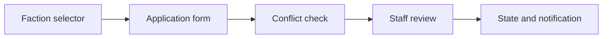

# Faction Reservation & Review Workflow

**Structured applications and limited faction-slot allocation**

  

> **Documentation-only portfolio case study.** The source under [`src/public_interface.py`](src/public_interface.py) is intentionally unimplemented and raises `NotImplementedError`. This is **not** a runnable bot, a deployment package or independently verified production evidence.

## Why this module exists

Group/faction applications in RP communities often involve a limited resource: one reservation or a finite set of places. Staff need a consistent way to review applications, prevent conflicting reservations and communicate a final outcome.

**Technology context:** Python, discord.py, persistent views, JSON state. These technologies describe the private module's documented domain; public executable implementation is not provided.

## Workflow at a glance

1. Display the eligible factions and their current availability
2. Collect a structured reservation request
3. Check that an active reservation does not conflict with the request
4. Route the application to authorized staff for a recorded decision
5. Update the faction state and notify the applicant

These stages summarize the public project description; the exact runtime and private integration details cannot be independently verified from the public skeleton.

## Engineering challenges

| Topic | Why it matters | How it should be verified |
|---|---|---|
| Competing claims | Two applicants may reserve the same faction simultaneously | Use atomic unique state or compare-and-swap |
| Expired requests | A stale pending case may block a faction indefinitely | Define expiry and recovery policy |
| Reviewer permissions | Faction-specific staff permissions may differ | Verify at review time and test role changes |
| Applicant identity | A notification or Discord message can disappear | Store request state independently of UI |

## Component boundary

This diagram is **conceptual**, not a snapshot of private production architecture. See the [design notes](docs/ARCHITECTURE.md) for boundaries, failure scenarios and test ideas.

## Repository contents and status

- [`src/public_interface.py`](src/public_interface.py) — non-runnable, documented public interface skeleton
- [`docs/ARCHITECTURE.md`](docs/ARCHITECTURE.md) — engineering design notes (no operational secrets)
- [`examples/config.example.jsonc`](examples/config.example.jsonc) — illustrative configuration shape, **not** a production configuration
- [`NOTICE.md`](NOTICE.md) and [`SECURITY.md`](SECURITY.md) — publication/security boundary

**Portfolio role:** Private faction-application module, currently presented only as an architectural case study. No public tests, executable deployment or usage metrics are claimed here. For verifiable code, inspect the [FastAPI backend demo](https://github.com/Scumbagsss/priority-access-bot), [ticket workflow](https://github.com/Scumbagsss/advanced-discord-ticket-bot) and [monitoring pipeline](https://github.com/Scumbagsss/dayz-server-monitor-bot).

**Related systems:** [rp-character-application-bot](https://github.com/Scumbagsss/rp-character-application-bot) · [BOT](https://github.com/Scumbagsss/BOT).

**Contact:** Discord `scumbagsss` · Telegram [@dilarion](https://t.me/dilarion)
